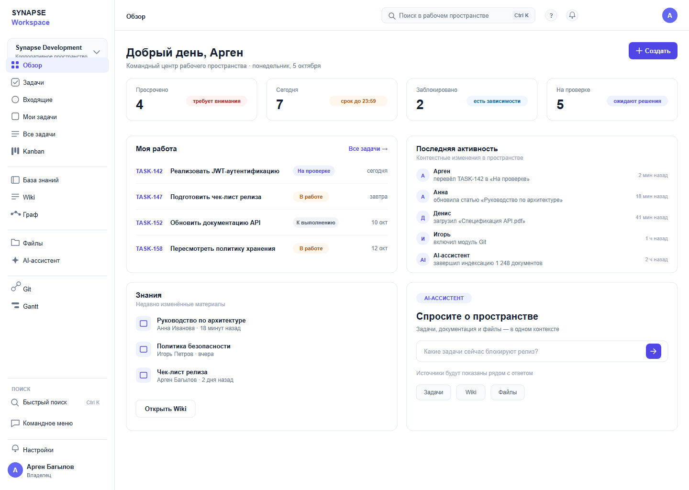

# Обзор

*Первый экран после входа. За пять секунд показывает, что происходит в пространстве
и за что браться сегодня.*

**Figma:** [01-overview](https://www.figma.com/design/eBMHOPmJtHXVp1gBuSu2NP/Synapse-Workspace?node-id=46-7869)
· **Собрано:** 9 октября · **Статус:** первый вариант, ждёт разбора с командой

---

## О чём экран

Человек заходит утром и должен понять, где горит и с чего начать. Поэтому экран
открывается не проектами и не лентой, а четырьмя цифрами и списком «Моя работа».

Собирал его как командный центр, а не как дашборд. Дашборд рассказывает, командный
центр отправляет в работу: каждая цифра наверху — это приглашение нажать и пойти дальше.

## Из чего состоит

**Метрики.** Четыре карточки: просрочено, на сегодня, заблокировано, на проверке.
Число крупно, рядом подсказка словами — «требует внимания», «срок до 23:59».
Цифра без подсказки ничего не значит: четыре просроченных и четыре готовых
выглядят одинаково, а означают противоположное.

**Моя работа.** Четыре задачи, которые ждут именно меня: номер, название, статус, срок.
Список намеренно короткий — это «взять и сделать», а не полный перечень. За остальным
ведёт ссылка «Все задачи».

**Активность.** Что изменилось в пространстве за последние часы: кто перевёл задачу,
кто обновил статью, кто загрузил файл. Нужна, чтобы не спрашивать в чате
«а что там по релизу».

**Знания.** Три недавно изменённых материала. Стоят на виду, потому что документация
в продукте — такая же рабочая поверхность, как задачи.

**Ассистент.** Блок с вопросом к пространству и подсказкой, какие источники он умеет
смотреть. Занимает четверть экрана намеренно — см. ниже.

## Откуда решения

Смотрел Linear, Notion и консоль Mistral:

- **Linear** — плотность и спокойная типографика. Взял ритм списка задач: строка,
  разделитель, ничего лишнего.
- **Notion** — структура левого меню. Взял группировку пунктов с заголовками разделов.
- **Mistral** — подача блока с ассистентом. Взял идею, что это рабочая зона, а не чат.

Пробовал поставить на первый экран графики и календарь. Отказался: на вопрос
«что мне делать сегодня» они не отвечают, а места занимают больше половины.

## Что решил и почему

**Приветствие по имени вместо заголовка «Обзор».** Экран личный, и обращение задаёт
тон: это моё пространство, а не отчёт для начальника.

**Четыре метрики, не шесть.** Дальше человек перестаёт выбирать и начинает читать
всё подряд. Если появится пятая — ей место на отдельном экране.

**Ассистент занимает четверть экрана, а не угол.** По ТЗ это рабочий инструмент,
а не справка. Маленький виджет в углу читается как «на всякий случай».

**Кнопка «Создать» в правом верхнем углу.** Люди дочитывают первую строку справа,
там её и ищут. В потоке контента она теряется.

**Статусы подписаны словами, не только цветом.** Дальтоники и чёрно-белая печать
не должны терять смысл.

## Что не получилось и над чем работаю

**Иконки.** Пока простые геометрические фигуры. Ищу набор под характер продукта:
строгий, но не безликий. Пробовал обводки 1.4 и 1.6 — на 16 пикселях первая смотрится
чище, на этом и остановлюсь, если не найду готовый набор.

**Блок «Знания» спорит с навигацией.** Wiki уже есть в левом меню, а тут — быстрый
доступ. Пока оставил, но подозреваю, что на реальных данных он дублирует меню.
Проверю, когда появятся настоящие материалы.

**Пустое состояние не рисовал.** А оно будет первым, что увидит новый пользователь:
пространство без задач и без команды. Нужно решить, что показывать вместо метрик.

**Правая колонка выглядит плотнее левой.** «Активность» и «Ассистент» стоят друг
под другом и перетягивают внимание. Думаю уменьшить высоту ассистента.

## Дальше

- [ ] Нарисовать состояния: пустое, загрузка, ошибка
- [ ] Подобрать набор иконок и заменить заглушки
- [ ] Развести «Знания» и раздел Wiki
- [ ] Уравновесить колонки по плотности
- [ ] Показать команде и собрать замечания

## Журнал по экрану

| Дата | Что делал |
|---|---|
| 5 окт | первый прогон композиции, сверил каркас с макетом из Figma |
| 7 окт | переделал строку метрик после сравнения с Linear |
| 9 окт | добавил блок ассистента, пересобрал в чистый SVG, собрал превью |
