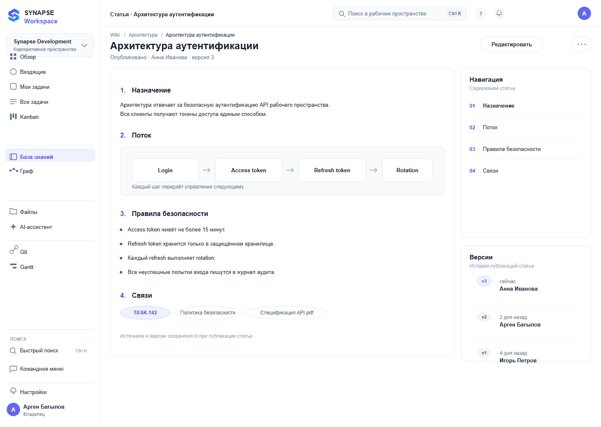

# 06 — Статья

*Просмотр опубликованной статьи: содержание, версии, связи.*

**Figma:** [06-article](https://www.figma.com/design/eBMHOPmJtHXVp1gBuSu2NP/Synapse-Workspace?node-id=118-7426)

---

## О чём экран
Страница статьи — то, что читают, а не то, что заполняют. Значит, на первом месте текст,
а служебное — версии и связи — уходит в стороны.

## Из чего состоит
**Шапка.** Хлебные крошки Wiki / Архитектура, заголовок, строка «Опубликовано · Анна Иванова ·
версия 3», кнопки «Редактировать» и меню.

**Тело.** Четыре нумерованных раздела: назначение, поток, правила безопасности, связи.
Внутри второго — схема Login → Access token → Refresh token → Rotation.

**Чипы связей** в конце: TASK-142, политика безопасности, спецификация API.

**Справа:** навигация по содержанию и список версий с авторами.

## Откуда решения
Разбивка на короткие нумерованные разделы — приём из документации Stripe и Linear.
Версии на виду — приём из Confluence, но там они спрятаны глубже, чем нужно.

## Что решил и почему
**Версии рядом с текстом.** В базе знаний важно, что менялось и когда.

**Связи чипами, а не списком.** Читается быстрее и не разрывает поток чтения.

**Нумерация разделов** даёт якоря и позволяет ссылаться на конкретный пункт.

## Что не получилось и над чем работаю
Сравнение версий не нарисовано: непонятно, как посмотреть, что изменилось между v2 и v3.

Комментариев к статье нет.

Состояние «статья устарела» не показано.

## Состояния и краевые случаи

- **Черновик:** бейдж DRAFT вместо PUBLISHED.
- **Статья устарела:** пометка и предложение обновить.
- **Нет прав на редактирование:** кнопка отключена с пояснением про роль.
- **Конфликт версий:** предупреждение, что статью изменили после открытия.
- **Загрузка версий:** скелетон списка.

Лист состояний целиком — в наборе [`synapse-figma-states/`](../../../synapse-figma-states).

## Дальше
- [ ] Сравнение версий
- [ ] Комментарии и предложения правок
- [ ] Пометка устаревшей статьи
