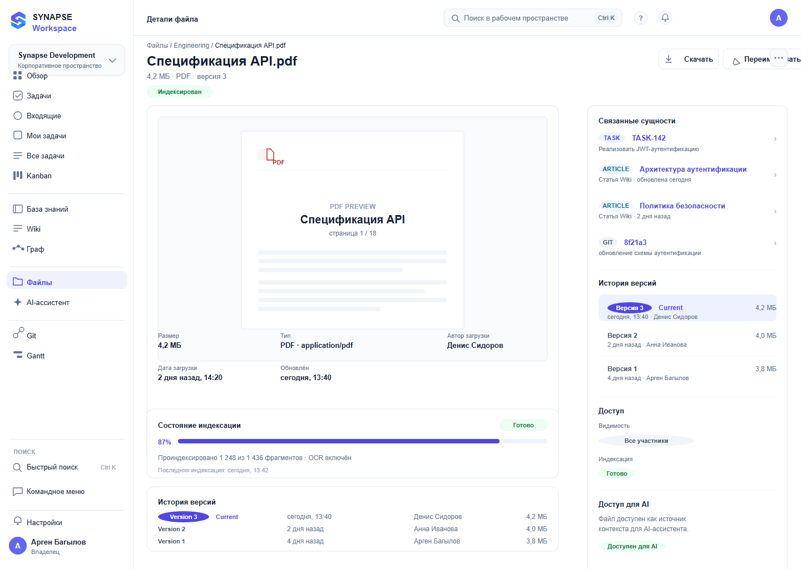

# 09 — Детали файла

*Файл как сущность знаний: превью, индексация, версии, связи.*

**Figma:** [09-file-detail](https://www.figma.com/design/eBMHOPmJtHXVp1gBuSu2NP/Synapse-Workspace?node-id=118-8060)

---

## О чём экран
Открывают, когда нужно понять, что это за документ, кто его принёс, откуда он взялся
в ответах ассистента и где используется.

## Из чего состоит
**Шапка.** Хлебные крошки, название файла, строка «4,2 МБ · PDF · версия 3», кнопки
«Скачать», «Переименовать», меню.

**Слева:** превью документа, метаданные (размер, тип, автор загрузки, даты), состояние
индексации с прогрессом и числом фрагментов, история версий.

**Справа:** связи — задачи, статьи, Git-коммит, и пометка, что файл доступен ассистенту.

## Откуда решения
Превью — от Drive и Dropbox. Идея «файл как сущность» — своя: раз ассистент отвечает
по содержимому, у файла должна быть карточка, как у задачи.

## Что решил и почему
**Связи на видном месте.** Ценность файла в том, где он используется.

**Версии рядом с метаданными**, а не в отдельной вкладке — это одна и та же история документа.

**Число фрагментов** показывает, как документ разобран для поиска. Это снимает вопросы
«почему ассистент отвечает неточно».

## Что не получилось и над чем работаю
Превью только для PDF — для таблиц и презентаций не решено.

Выделение фрагментов документа нет.

Состояние «файл заблокирован» не показано.

## Состояния и краевые случаи

- **Не проиндексирован:** «Файл не проиндексирован» и кнопка запуска.
- **Файл удалён:** «Файл не найден» и возврат к списку.
- **Превью недоступно:** сообщение и кнопка «Скачать».
- **Одна версия:** блок истории скрыт, чтобы не показывать пустой список.
- **Большой файл:** превью не строится — предлагаем скачать.

Лист состояний целиком — в наборе [`synapse-figma-states/`](../../../synapse-figma-states).

## Дальше
- [ ] Превью для других типов файлов
- [ ] Состояние «идёт переиндексация»
- [ ] Связь с фрагментом, на который сослался ассистент
