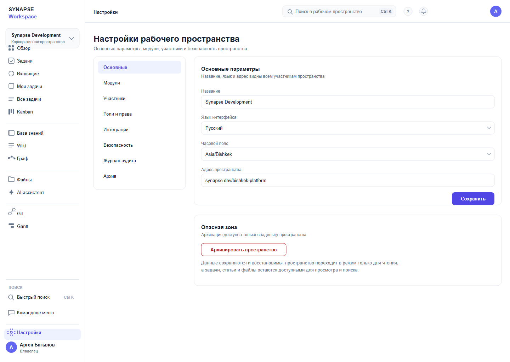

# 11 — Настройки пространства

*Параметры пространства и опасные действия отдельно.*

**Figma:** [11-settings](https://www.figma.com/design/eBMHOPmJtHXVp1gBuSu2NP/Synapse-Workspace?node-id=118-8503)

---

## О чём экран
Настройки открывают редко, но по делу: поменять название, язык, часовой пояс, архивировать
пространство. Значит, важнее всего — чтобы опасное действие нельзя было нажать случайно.

## Из чего состоит
**Вертикальное меню разделов.** Основные, модули, участники, роли и права, интеграции,
безопасность, журнал аудита, архив. Первый пункт активен.

**Карточка основных параметров.** Название, язык интерфейса, часовой пояс, адрес пространства,
кнопка «Сохранить».

**Опасная зона.** Архивирование пространства с пояснением, что данные сохраняются
и восстановимы.

## Откуда решения
Вертикальное меню — из Notion, карточки параметров — из настроек Linear.
Опасную зону вынес отдельной карточкой вниз: так принято в GitHub и это работает.

## Что решил и почему
**Опасное действие отдельно и с объяснением.** «Данные сохраняются и восстановимы» снимает
страх и снижает число случайных архиваций.

**Язык интерфейса — настройка пространства, а не пользователя.** Так требует ТЗ: язык общий
для команды.

**Сохранить — одна кнопка на карточку**, а не на весь экран.

## Что не получилось и над чем работаю
Разделы «Модули», «Интеграции», «Безопасность» показаны только пунктами меню — экранов нет.

Не показано, что будет, если название пространства уже занято.

Нет состояния «изменения не сохранены».

## Дальше
- [ ] Экраны остальных разделов настроек
- [ ] Состояние несохранённых изменений
- [ ] Ошибки валидации полей
