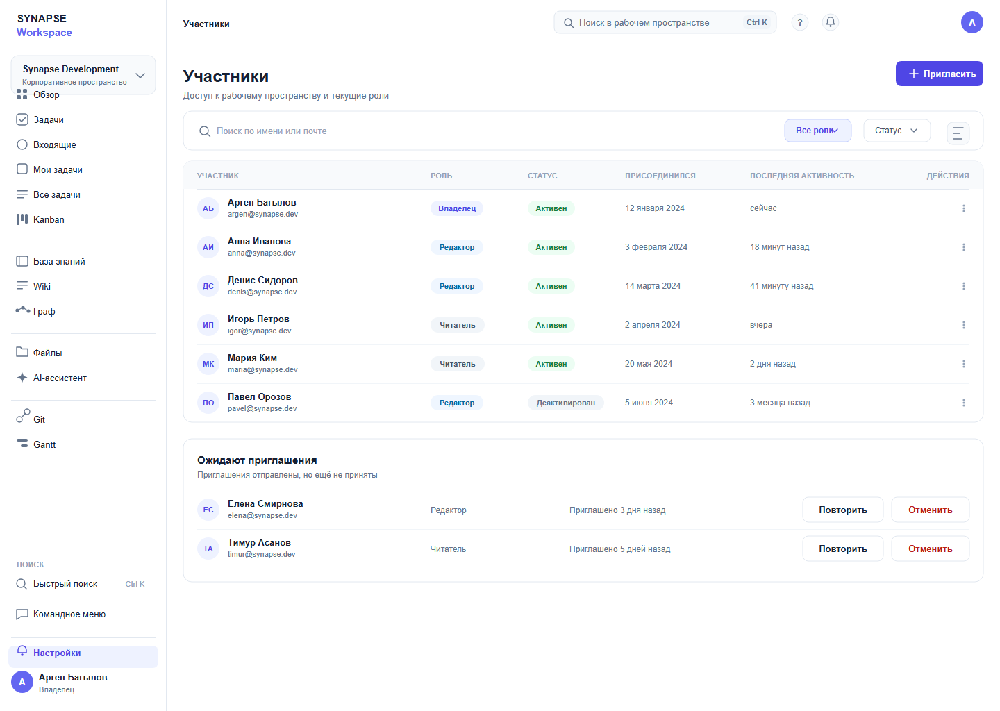

# 12 — Участники

*Кто имеет доступ и с какой ролью.*

**Figma:** [12-members](https://www.figma.com/design/eBMHOPmJtHXVp1gBuSu2NP/Synapse-Workspace?node-id=118-8647)

---

## О чём экран
Экран нужен, чтобы понимать состав команды и вовремя убирать доступ. Отдельно показаны
приглашённые, которые ещё не зашли, — это другой статус, и путать его с участником нельзя.

## Из чего состоит
**Панель действий.** Кнопка «Пригласить», поиск по имени или почте, фильтр по ролям,
фильтр по статусу.

**Таблица участников.** Шесть строк: аватар с инициалами, имя, почта, роль, статус,
дата присоединения, последняя активность, меню действий.

**Блок «Ожидают приглашения».** Две строки с действиями «Повторить» и «Отменить».

## Откуда решения
Таблица — из Linear, где участники и приглашения разведены по разным блокам. Это и взял:
приглашённый — не участник.

## Что решил и почему
**Последняя активность в таблице.** Сразу видно, живой аккаунт или забытый.

**Приглашения отдельным блоком** с повтором и отменой: у них свои действия.

**Роль прямо в строке** — не нужно открывать карточку участника, чтобы понять, кто он.

## Что не получилось и над чем работаю
Состояние «участник покинул пространство» не показано.

Массовых действий нет — а при увольнении нужно снять доступ у нескольких сразу.

Не показано, что видит сам участник со своей ролью.

## Дальше
- [ ] Состояние «покинул пространство»
- [ ] Массовые действия над участниками
- [ ] Связь с экраном ролей
