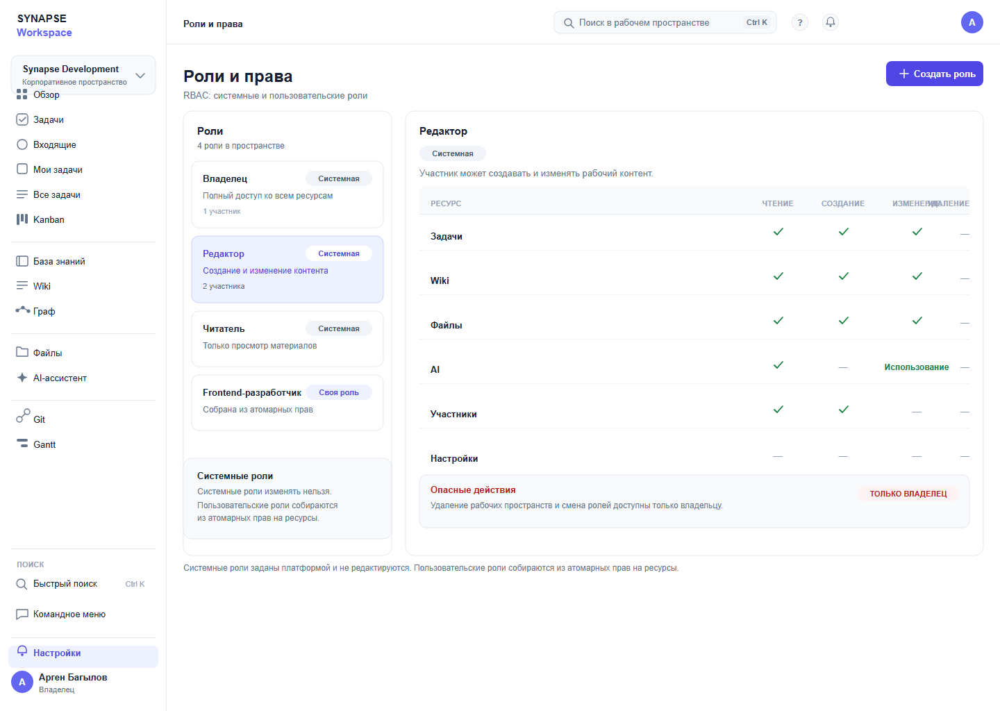

# 13 — Роли и права

*RBAC: системные и пользовательские роли, атомарные права.*

**Figma:** [13-roles](https://www.figma.com/design/eBMHOPmJtHXVp1gBuSu2NP/Synapse-Workspace?node-id=118-8894)

---

## О чём экран
Экран отвечает на вопрос «кто что может». Матрица нужна не для красоты, а чтобы видеть
пересечения: где две роли дают одно и то же, а где у одной есть лишнее.

## Из чего состоит
**Список ролей слева.** Четыре роли: владелец, редактор, читатель и одна пользовательская.
У системных — бейдж «Системная», описание и число участников.

**Матрица прав справа.** Строки — ресурсы: задачи, Wiki, файлы, AI, участники, настройки.
Столбцы — чтение, создание, изменение, удаление. Отметки чекбоксами.

**Пояснение внизу:** системные роли изменять нельзя, пользовательские собираются
из атомарных прав.

## Откуда решения
Матрица взята из матрицы прав в ТЗ. Форма подачи — как у ролей организации в GitHub,
но там список, а здесь именно матрица: видно пересечения ролей.

## Что решил и почему
**Матрица, а не чек-листы по ролям.** Сравнивать роли можно только рядом.

**Системные роли помечены и защищены** — их нельзя случайно переписать.

**Число участников у роли.** Видно, что роль не абстрактная, а за ней люди.

## Что не получилось и над чем работаю
Наследование прав не показано: непонятно, что произойдёт с пользовательской ролью,
если поменять системную.

Связи с экранами нет: не видно, что именно увидит читатель на экране задач.

## Дальше
- [ ] Наследование и конфликты прав
- [ ] Связь роли с экранами интерфейса
- [ ] Состояние «роль используется участниками»
