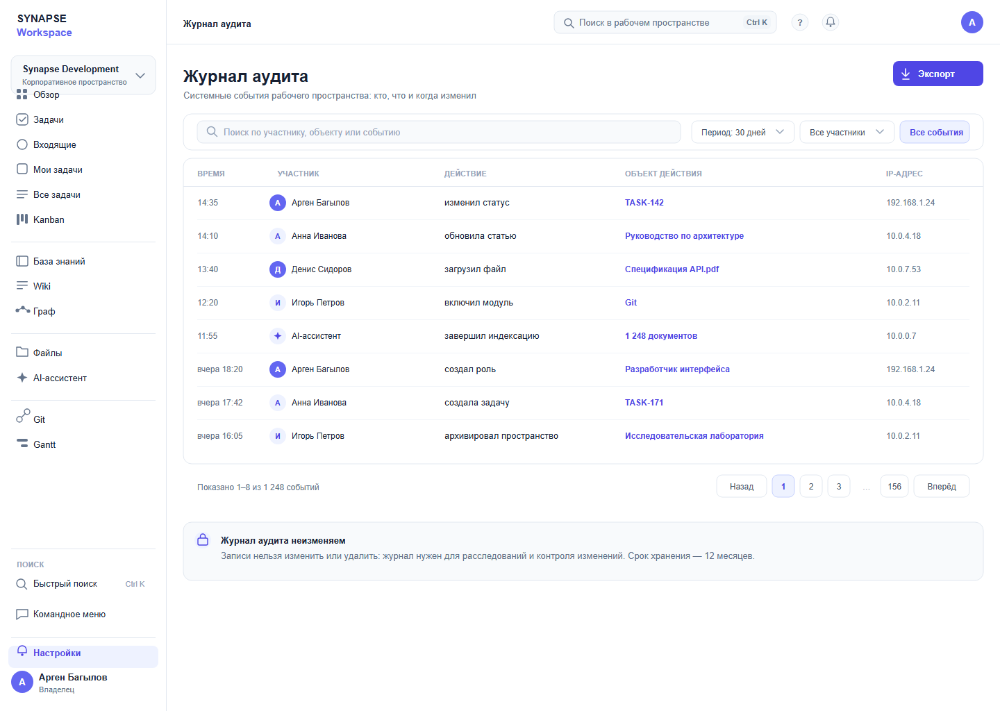

# 16 — Журнал аудита

*Кто что сделал в пространстве — по событиям и времени.*

**Figma:** [16-audit](https://www.figma.com/design/eBMHOPmJtHXVp1gBuSu2NP/Synapse-Workspace?node-id=118-9518)

---

## О чём экран
Журнал нужен для разбора: кто изменил статус, кто включил модуль, кто архивировал
пространство. Он же главный аргумент, что в системе есть контроль доступа.

## Из чего состоит
**Строка фильтров.** Период, участник, тип события, поиск по участнику, объекту и событию.
Кнопка «Экспорт».

**Таблица событий.** Восемь строк: время, участник, действие, объект действия, IP-адрес.

**Пагинация** и пояснение, что журнал неизменяем.

## Откуда решения
Принцип формулировки «действие в прошедшем времени» — из журнала аудита GitHub:
«изменил статус», «загрузил файл», «включил модуль». Так запись читается как факт.

## Что решил и почему
**Действия словами в прошедшем времени.** «Изменил статус» понятнее, чем код события.

**Объект действия отдельной колонкой** — иначе непонятно, что именно изменили.

**Явное пояснение, что журнал неизменяем.** Это обещание пользователю, а не деталь.

## Что не получилось и над чем работаю
Раскрытия события в детали нет: не видно, что было до и что стало после.

Фильтра по объекту нет — только по типу события.

Состояние «событий за период нет» не отрисовано.

## Дальше
- [ ] Карточка события с деталями
- [ ] Фильтр по объекту
- [ ] Пустой результат фильтра
