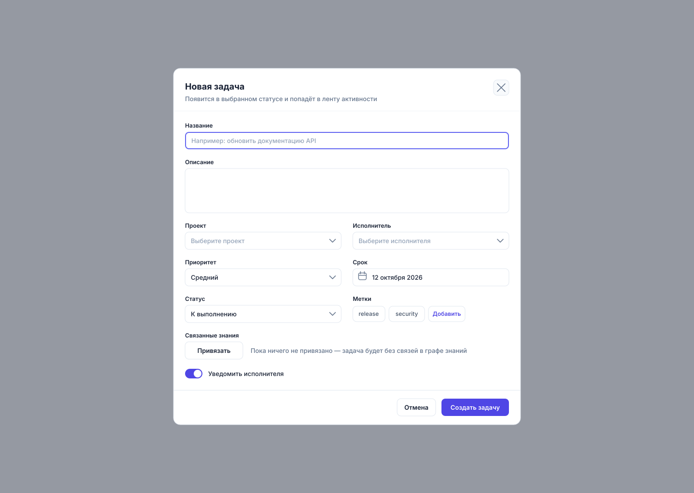

# m01 — Создание задачи (модальное окно)

> **Тип:** lg, ширина 720 · **Экран:** `m01-create-task.svg` · **Холст:** 1440×1024
> **Figma:** [Synapse Workspace → m01-create-task](https://www.figma.com/design/eBMHOPmJtHXVp1gBuSu2NP/Synapse-Workspace?node-id=121-10549)
> **Правила:** [../RULES.md](../RULES.md) · **Бренд:** [../BRAND.md](../BRAND.md) · **Задачи:** [../TASKS.md](../TASKS.md)
> **Статус:** собран, автопроверка XML пройдена

> Вектор: [`img/m01-create-task.svg`](../img/m01-create-task.svg).

## 1. Назначение и роль в сценарии

Быстрое создание задачи без перехода на отдельный экран. Контекст страницы
сохраняется: пользователь создаёт задачу из «Обзора», «Задач» или канбана
и остаётся там же.

## 2. Состав окна

| Блок | Идентификатор | Что внутри |
|---|---|---|
| Затемнение | `backdrop` | `#172033`, прозрачность 0.45, на весь холст |
| Диалог | `dialog` | 720×740, `x 360..1080`, `y 142..882`, rx 14, рамка `#E2E8F0` |
| Шапка | `dialog-head` | заголовок «Новая задача», подзаголовок, кнопка закрытия 32×32, разделитель |
| Тело | `dialog-body` | 9 полей в две колонки |
| Подвал | `dialog-foot` | разделитель, «Отмена», «Создать задачу» |

Поля тела: Название (в фокусе), Описание, Проект / Исполнитель, Приоритет / Срок,
Статус / Метки, Связанные знания, Уведомить исполнителя.

## 3. Использованные компоненты и токены

| Компонент | Где | Параметры |
|---|---|---|
| Диалог `lg` | `dialog-surface` | ширина 720, rx 14, `#FFFFFF`, рамка `#E2E8F0` |
| Затемнение | `backdrop` | `#172033` с `fill-opacity="0.45"` |
| Поле в фокусе | `input-title-focus` | рамка 2 px `#6366F1` вместо 1 px `#E2E8F0` |
| Поле ввода | `input-description`, `input-due` | h 36 и 92, rx 7–8, рамка `#E2E8F0` |
| Select | `select-project`, `select-assignee`, `select-priority`, `select-status` | как поле, шеврон справа, ширина 324 |
| Чип-метка | `chip-release`, `chip-security` | h 32, rx 8, подпись 12/500 `#475569` |
| Чип-действие | `btn-add-label` | как чип, подпись 12/600 `#4F46E5` |
| Переключатель | `toggle-notify` | дорожка 36×20 rx 10 `#4F46E5`, кнопка 8 `#FFFFFF` |
| Кнопка основная | `btn-create` | h 36, rx 8, `#4F46E5`, подпись 13/600 `#FFFFFF` |
| Кнопка вторичная | `btn-cancel`, `btn-link` | h 36, rx 8, `#FFFFFF`, рамка `#E2E8F0` |
| Кнопка-иконка | `btn-close` | 32×32, rx 8, крест 1.6 `#64748B` |

Отклонение от общего контракта: вместо групп `sidebar` / `topbar` / `content`
используются `backdrop` и `dialog` — это описано в `<desc>` файла.

## 4. UX/UI-подход и обоснование

- **Модальное окно, а не страница.** Создание задачи — короткое действие на 5–7 полей.
  Полноэкранная форма стоила бы пользователю потери контекста, ради которого он
  и пришёл на «Обзор».
- **Автофокус на первом поле.** `input-title-focus` нарисован в состоянии фокуса:
  пользователь может печатать сразу, не наводя мышь. Это экономит одно действие.
- **Парные поля в две колонки.** Проект + Исполнитель, Приоритет + Срок, Статус + Метки —
  связанные по смыслу пары стоят рядом, поэтому окно читается сверху вниз без возвратов.
- **Обязательное поле одно — название.** Остальные предзаполнены разумными значениями
  («Средний» приоритет, «К выполнению» статус, срок по умолчанию). Форма не заставляет
  заполнять всё, чтобы создать задачу.
- **Прогрессивное раскрытие связей.** Блок «Связанные знания» не разворачивается в окне:
  кнопка «Привязать» открывает отдельный шаг `m09-link-entity`. Так окно не растёт.
- **Текст пустого состояния объясняет последствие, а не констатирует пустоту:**
  «Пока ничего не привязано — задача будет без связей в графе знаний».
- **Порядок кнопок в подвале: отмена → основное действие, справа налево.**
  Опасных действий в окне нет, поэтому подтверждение не требуется.
- **Уведомление исполнителя включено по умолчанию** — задача без уведомления
  с высокой вероятностью останется незамеченной. Пользователь может выключить.
- **Доступность:** фокус видимый (2 px `#6366F1`), кнопка закрытия ≥ 32×32,
  подписи полей связаны с полями позицией и кеглем 12/600.

## 5. Соответствие правилам

- [x] Холст 1440×1024, есть `viewBox`, `<title>`, `<desc>`
- [x] Отклонение от групп `sidebar`/`topbar`/`content` описано в `<desc>`
- [x] Нет `<style>`, `<image>`, `transform`, `filter`, `mask`, классов, эмодзи
- [x] Все цвета из палитры, кегль не меньше 11 px (метки полей 12/600)
- [x] Фокус показан рамкой 2 px `#6366F1`
- [x] Размер файла 7,9 КБ
- [ ] Нет состояния ошибки валидации (пустое название)
- [ ] Нет состояния «сохранение» на кнопке

## 6. Состояния и краевые случаи

| Состояние | Есть | Что нужно |
|---|---|---|
| Основное | да | — |
| Фокус поля | да, на «Названии» | остальные поля |
| Ошибка валидации | нет | красная рамка + текст под полем |
| Сохранение | нет | кнопка в состоянии загрузки |
| Много меток | нет | перенос на вторую строку или счётчик «+3» |
| Длинный список исполнителей | нет | поведение select при 50+ участниках |
| Клавиатура | описано | `Esc` закрывает, фокус замыкается внутри диалога |

## 7. Что уже есть в коде

| Артефакт дизайна | Код | Состояние |
|---|---|---|
| окно целиком | `frontend/src/shared/ui/Modal.tsx` (1,4 КБ) | компонент есть, разметка полей не сверялась |
| поля | `frontend/src/shared/ui/Input.tsx` (1,1 КБ) | компонент есть |
| кнопки | `frontend/src/shared/ui/Button.tsx` | компонент есть |
| создание задачи | `frontend/src/features/tasks/api/tasksApi.ts` | API-вызов есть |

## 8. Открытые вопросы

1. Нужны ли обязательные поля кроме названия — например, проект?
2. Что делать при закрытии с заполненными полями: предупреждать или сохранять черновик?
3. «Уведомить исполнителя» — по умолчанию включено. Согласовать с командой.
